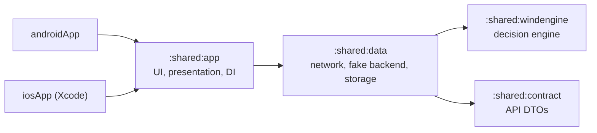

# Pursuit Of Wind

**Know when to go. Know who's driving.**

Kitesurfers who live hours from the water lose whole days to forecasts that looked fine on paper. Pursuit Of Wind turns the raw forecast into one answer — *go or no-go, when, where, with which kite and when to leave* — and shows who from your crew is driving with free seats.

> **Status:** client phase. The decision engine, the API contract and the in-app fake backend are done; the data layer is next. See the [roadmap](#roadmap).

## What is in this repository

A Kotlin Multiplatform client for Android and iOS with a shared Compose Multiplatform UI. The backend is a separate project; until it exists, the app runs against an in-app fake backend that implements the same API contract.



| Module | Targets | Purpose |
| --- | --- | --- |
| `:shared:windengine` | Android, iOS, JVM | Pure-Kotlin decision engine: verdicts, session windows, kite size, day decisions. Reused by the server. |
| `:shared:contract` | Android, iOS, JVM | DTOs mirroring [`api/openapi.yaml`](api/openapi.yaml). Reused by the server. |
| `:shared:data` | Android, iOS, JVM | In-app fake backend. *Planned:* Ktor client, Room, DataStore, repositories. |
| `:testing:openapi` | JVM, tests only | Validates requests and responses against [`api/openapi.yaml`](api/openapi.yaml). |
| `:shared:app` | Android, iOS | Compose Multiplatform UI, ViewModels, navigation, DI. Exported to iOS as `PursuitOfWindKit`. |
| `:androidApp` | Android | Android entry point. |
| `iosApp/` | iOS | Xcode project hosting the shared UI. |

Allowed dependencies are enforced by `checkModuleGraph`, part of `./gradlew check` ([ADR 0002](docs/adr/0002-module-structure-and-dependency-rules.md)).

## Decision engine

For every forecast hour the engine combines the weather models, checks wind range for the rider's level, gusts, direction against the spot's rideable and dangerous sectors, thunderstorms, rain, cold and daylight, and picks a kite from the rider's quiver. Rideable hours become session windows with a leave-by time, a confidence from model agreement and a score; the best window across the rider's spots becomes the day's GO, otherwise a NO-GO with the main reason and the next GO day. Day boundaries follow each spot's time zone, including daylight saving changes.

The rules, thresholds and formulas are in [`docs/domain-rules.md`](docs/domain-rules.md). Each rule has a table-driven test vector; seeded property tests cover angles, sectors, kite sizing and window structure; coverage of the module is enforced at 90% ([ADR 0004](docs/adr/0004-decision-engine-as-pure-kotlin.md)).

## API contract

[`api/openapi.yaml`](api/openapi.yaml) (OpenAPI 3.1) is the single source of truth for the client, the in-app fake server and the future backend: anonymous auth, rider profile, spots, hourly forecasts per weather model, crews, rides with seats, and a crew event feed. Errors are `application/problem+json` with a machine-readable code; mutations accept an `Idempotency-Key`.

Contract tests in `:shared:contract` parse the spec, check its conventions (operation ids, `401` on authenticated calls, `Idempotency-Key` on mutations, problem bodies for every error), validate every example against its schema, and require each schema and its DTO to have exactly the same fields, required fields and types. The shared route table `ApiRoute` is checked against the spec too. Changes are logged in [`api/CHANGELOG.md`](api/CHANGELOG.md).

## Fake backend

Until the server exists, the app talks to `FakePursuitOfWindServer`: a Ktor `MockEngine` that implements every operation of the contract with in-memory state — anonymous sign-in with rotating refresh tokens, profiles, a spot catalog with cursor paging, generated forecasts for three weather models, crews with invite codes, rides with seat counting and versions, a crew feed with paging and `410 FEED_RESET`, and `Idempotency-Key` replay. The app's real HTTP client runs against it, so moving to the real backend means a different engine and base URL ([ADR 0005](docs/adr/0005-contract-first-api-with-in-app-fake-backend.md)).

Everything is deterministic for a seed and a clock: ids, tokens, forecasts (synoptic swings, an afternoon sea breeze, model spread and a daylight flag from the sunrise equation) and simulated network trouble — `SLOW`, `FLAKY` (`503` with `Retry-After`) and `OFFLINE`. A tour test calls every route with its success and error cases. On the JVM every recorded request (parameters and body) and response is validated against the spec, and the build fails if a documented status or crew event type is never reached, or if the fake accepts a request the spec rejects. The fake enforces no rule that is not in the spec.

## Build and run

Requirements: JDK 21, Android Studio with the Android SDK (API 37), and Xcode 26.4 or newer on macOS for iOS. Versions of everything else are pinned in [`gradle/libs.versions.toml`](gradle/libs.versions.toml).

Xcode builds the shared framework by running Gradle from a build phase with a minimal environment. If Xcode cannot find Java, set `JAVA_HOME` or install a JDK that `/usr/libexec/java_home` can see; the build phase also looks for SDKMAN's current JDK and Android Studio's bundled runtime.

```bash
./scripts/setup.sh                      # checks the toolchain, writes local.properties
./scripts/check.sh                      # what CI runs: ktlint, detekt, Lint, tests, module rules, coverage, debug APK
./gradlew :androidApp:installDebug      # run on a connected device or emulator
open iosApp/iosApp.xcodeproj            # then Run on an iOS simulator
```

## Engineering decisions

| ADR | Decision |
| --- | --- |
| [0001](docs/adr/0001-kotlin-multiplatform-and-compose-multiplatform.md) | Kotlin Multiplatform with Compose Multiplatform for both UIs |
| [0002](docs/adr/0002-module-structure-and-dependency-rules.md) | Module structure for AGP 9 and enforced dependency rules |
| [0003](docs/adr/0003-dependency-version-policy.md) | Stable dependencies inside Kotlin's tested compatibility range |
| [0004](docs/adr/0004-decision-engine-as-pure-kotlin.md) | Decision engine as pure Kotlin for three runtimes |
| [0005](docs/adr/0005-contract-first-api-with-in-app-fake-backend.md) | Contract-first API with an in-app fake backend at the HTTP layer |

## Roadmap

1. Bootstrap: build, modules, CI — done
2. Decision engine: verdicts, windows, kite sizing — done
3. API contract and in-app fake backend — done
4. Data layer: network, cache, offline — next
5. Screens: Today, Spot detail, Spots, Crew, Settings
6. Demo mode with scripted scenarios
7. Background evaluation and local notifications
8. Server phase (separate repository)

## Disclaimer

Pursuit Of Wind supports a decision; it does not replace judging conditions on the spot and is not safety advice.

## License

[Apache License 2.0](LICENSE). The `iosApp` Xcode project scaffolding is adapted from JetBrains' [KMP-App-Template](https://github.com/Kotlin/KMP-App-Template) (Apache 2.0).
