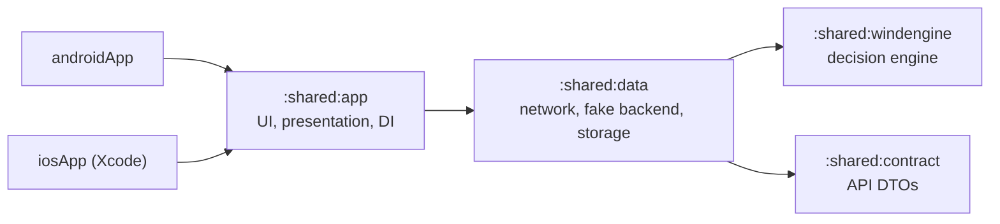

# Pursuit Of Wind

**Know when to go. Know who's driving.**

Kitesurfers who live hours from the water lose whole days to forecasts that looked fine on paper. Pursuit Of Wind turns the raw forecast into one answer — *go or no-go, when, where, with which kite and when to leave* — and shows who from your crew is driving with free seats.

> **Status:** client phase. The decision engine, the API contract, the in-app fake backend, the data layer, the Today screen and the spot's hourly wind chart are done; the other screens are next. See the [roadmap](#roadmap).

## What is in this repository

A Kotlin Multiplatform client for Android and iOS with a shared Compose Multiplatform UI. The backend is a separate project; until it exists, the app runs against an in-app fake backend that implements the same API contract.



| Module | Targets | Purpose |
| --- | --- | --- |
| `:shared:windengine` | Android, iOS, JVM | Pure-Kotlin decision engine: verdicts, session windows, kite size, day decisions. Reused by the server. |
| `:shared:contract` | Android, iOS, JVM | DTOs mirroring [`api/openapi.yaml`](api/openapi.yaml). Reused by the server. |
| `:shared:data` | Android, iOS, JVM | Ktor client, offline cache (Room 3, DataStore), repositories, secure token storage, in-app fake backend. |
| `:testing:openapi` | JVM, tests only | Validates requests and responses against [`api/openapi.yaml`](api/openapi.yaml). |
| `:shared:app` | Android, iOS (JVM for tests) | Compose Multiplatform UI in feature packages with MVI, the design system, navigation, DI. Exported to iOS as `PursuitOfWindKit`. |
| `:androidApp` | Android | Android entry point. |
| `iosApp/` | iOS | Xcode project hosting the shared UI. |

Allowed dependencies are enforced by `checkModuleGraph`, part of `./gradlew check` ([ADR 0002](docs/adr/0002-module-structure-and-dependency-rules.md)).

## Decision engine

For every forecast hour the engine combines the weather models, checks wind range for the rider's level, gusts, direction against the spot's rideable and dangerous sectors, thunderstorms, rain, cold and daylight, and picks a kite from the rider's quiver. Rideable hours become session windows with a leave-by time, a confidence from model agreement and a score; the best window across the rider's spots becomes the day's GO, otherwise a NO-GO with the main reason and the next GO day. Day boundaries follow each spot's time zone, including daylight saving changes.

The rules, thresholds and formulas are in [`docs/domain-rules.md`](docs/domain-rules.md). Each rule has a table-driven test vector; seeded property tests cover angles, sectors, kite sizing and window structure; coverage of the module is enforced at 90% ([ADR 0004](docs/adr/0004-decision-engine-as-pure-kotlin.md)).

## API contract

[`api/openapi.yaml`](api/openapi.yaml) (OpenAPI 3.1) is the single source of truth for the client, the in-app fake server and the future backend: anonymous auth, rider profile, spots, hourly forecasts per weather model, crews, rides with seats, and a crew event feed. Errors are `application/problem+json` with a machine-readable code; mutations accept an `Idempotency-Key`.

Contract tests in `:shared:contract` parse the spec, check its conventions (operation ids, `401` on authenticated calls, `Idempotency-Key` on mutations, problem bodies for every error), validate every example against its schema, and require each schema and its DTO to have exactly the same fields, required fields and types. The shared route table `ApiRoute` is checked against the spec too. Changes are logged in [`api/CHANGELOG.md`](api/CHANGELOG.md).

## Fake backend

Until the server exists, the app talks to `FakePursuitOfWindServer`: an in-process Ktor engine that implements every operation of the contract with in-memory state — anonymous sign-in with rotating refresh tokens, profiles, a spot catalog with cursor paging, generated forecasts for three weather models, crews with invite codes, rides with seat counting and versions, a crew feed with paging and `410 FEED_RESET`, and `Idempotency-Key` replay. The app's real HTTP client runs against it, so moving to the real backend means a different engine and base URL ([ADR 0005](docs/adr/0005-contract-first-api-with-in-app-fake-backend.md)).

It behaves like a live server: every forecast request is a new model run that moves the wind a little — less for the next hours, more three days out — so pulling to refresh always brings a slightly different forecast. There is no separate demo mode ([ADR 0010](docs/adr/0010-live-fake-backend-instead-of-demo-mode.md)).

Everything is still deterministic for a seed, a clock and a sequence of requests: ids, tokens, forecasts (synoptic swings, an afternoon sea breeze, model spread, model runs and a daylight flag from the sunrise equation) and simulated network trouble — `SLOW`, `FLAKY` (`503` with `Retry-After`) and `OFFLINE`. A tour test calls every route with its success and error cases. On the JVM every recorded request (parameters and body) and response is validated against the spec, and the build fails if a documented status or crew event type is never reached, or if the fake accepts a request the spec rejects. The fake enforces no rule that is not in the spec.

## Data and offline

Screens read from a local cache and never wait for the network: repositories expose Room `Flow`s together with the time of the last fetch ("updated 2 h ago"), and `refresh` calls update the cache in the background. Forecasts, spots and the profile come out as the decision engine's own types, so screens and background checks pass them to `DecisionEngine` unchanged.

- **Session:** the app signs in anonymously with an installation id on first use, refreshes the access token on `401` (one refresh for all parallel requests), and signs in again with the same installation id if a refresh is refused. Tokens are encrypted with an AES-GCM key from the Android Keystore, or kept in the iOS Keychain.
- **Errors:** every failure reaches the UI as one `AppError` (`Network`, `Unauthorized`, `Conflict(code)`, `Rejected(status, code)`, `Server(status)`, `Unknown`); exceptions are mapped in one place.
- **Retries:** reads, and writes that carry an `Idempotency-Key`, are retried with exponential back-off that honors `Retry-After`; every user action gets its own key, so a retry is never applied twice.
- **Crew updates:** rides carry a server `version`, and the cache only moves a ride forward. The crew feed is replayed from the last applied event; when the server resets it (`410 FEED_RESET`) the crew is loaded again.
- **Optimistic seats:** taking or releasing a seat shows the result at once and is rolled back, with the server's state, if the server says no (for example `409 SEATS_FULL`).
- **Isolation:** each environment (fake backend, real server) has its own database, settings and secure store. With the fake backend no data leaves the device.

Choices and trade-offs: [ADR 0006](docs/adr/0006-room-3-as-the-offline-cache.md) (Room 3) and [ADR 0007](docs/adr/0007-koin-for-dependency-injection.md) (Koin).

## Today

The first screen answers "go?" for today and the next two days, across the rider's favorite spots.

- **GO** names the spot, the window in the spot's local time, the wind range in the rider's unit, the kite, when to leave (or "leave now"), how much the weather models agree, and who from the crew is driving there that day with how many free seats. The next best windows follow as alternatives.
- **NO-GO** gives the main reason in plain words, the reason at each spot, and the next good day.
- Every state is designed: placeholders while the first answer loads, a prompt when the profile or a favorite spot is missing, an error with retry when there is nothing cached, and cached answers with a notice when the device is offline, the forecast is getting old or the crew's rides could not be updated.
- The screen refreshes when it opens, when it comes back after half an hour or after a failed refresh, and on pull-to-refresh. Decisions are recomputed every minute, so "leave by" stays true while the screen is open; once the time to leave has passed, the card shows only the riding time that is left.
- Verdicts are an icon, a word and a color, never color alone. Each day reads as one heading item to screen readers, which also get a "Refresh" action instead of the pull gesture. Light and dark themes, English and Russian, and a test that no text is cut off at twice the font size.

Each screen is a feature package with `domain`, `data`, `presentation` and `di` layers, and its ViewModel follows MVI: intents and incoming data become results, a pure reducer folds them into the state the view renders ([ADR 0008](docs/adr/0008-mvi-presentation-in-feature-packages.md)).

The screen is tested on the desktop JVM without an emulator: its ViewModel against the real data layer (fake backend, Room, DataStore), and the UI with Compose UI tests.

## Spot detail

Tapping a day on Today opens that spot's forecast for today and the next two days, hour by hour, scrolled to the window of that day.

- The wind chart is drawn on a canvas, without a chart library. Each hour gets a bar of mean wind in the color of its verdict, a tick at the gusts, and an arrow for the direction. A band shows how far apart the weather models are. Session windows and night are tinted, and the time axis uses the spot's time zone; both hours of a clock change keep their own label. The chart scrolls sideways, and chips jump to a day.
- Tapping an hour shows it in words: wind, gusts, direction, each model, the kite, and every reason it is not a GO. Below the chart, the windows are listed with the riding time, the kite and when to leave.
- The drawing is for the eye only. On top of it, one invisible cell per hour is read by screen readers ("Saturday 13:00: 20 kn, gusts 25 kn, wind from the west, GO") and takes taps, so the chart works without seeing it. Back and refresh are buttons in the top bar, not only gestures. Time runs left to right in right-to-left languages too.
- The states are the same as on Today: loading, an error with retry, cached data with a notice, and a message when the rider no longer follows the spot.

Screens are connected with Navigation 3 in one place, `app.navigation`. The back stack is a list of serializable destinations, each with its own ViewModel; Today asks for a spot through an MVI effect and does not know the spot screen ([ADR 0009](docs/adr/0009-navigation-3.md)).

## Build and run

Requirements: JDK 21, Android Studio with the Android SDK (API 37), and Xcode 26.4 or newer on macOS for iOS. Versions of everything else are pinned in [`gradle/libs.versions.toml`](gradle/libs.versions.toml).

Xcode builds the shared framework by running Gradle from a build phase with a minimal environment. If Xcode cannot find Java, set `JAVA_HOME` or install a JDK that `/usr/libexec/java_home` can see; the build phase also looks for SDKMAN's current JDK and Android Studio's bundled runtime.

```bash
./scripts/setup.sh                      # checks the toolchain, writes local.properties
./scripts/check.sh                      # what CI runs: ktlint, detekt, Lint, tests, module rules, coverage, debug APK
./gradlew :androidApp:installDebug      # run on a connected device or emulator
open iosApp/iosApp.xcodeproj            # then Run on an iOS simulator
```

## Engineering decisions

| ADR | Decision |
| --- | --- |
| [0001](docs/adr/0001-kotlin-multiplatform-and-compose-multiplatform.md) | Kotlin Multiplatform with Compose Multiplatform for both UIs |
| [0002](docs/adr/0002-module-structure-and-dependency-rules.md) | Module structure for AGP 9 and enforced dependency rules |
| [0003](docs/adr/0003-dependency-version-policy.md) | Stable dependencies inside Kotlin's tested compatibility range |
| [0004](docs/adr/0004-decision-engine-as-pure-kotlin.md) | Decision engine as pure Kotlin for three runtimes |
| [0005](docs/adr/0005-contract-first-api-with-in-app-fake-backend.md) | Contract-first API with an in-app fake backend at the HTTP layer |
| [0006](docs/adr/0006-room-3-as-the-offline-cache.md) | Room 3 as the offline cache |
| [0007](docs/adr/0007-koin-for-dependency-injection.md) | Koin for dependency injection |
| [0008](docs/adr/0008-mvi-presentation-in-feature-packages.md) | MVI presentation in feature packages |
| [0009](docs/adr/0009-navigation-3.md) | Navigation 3 for moving between screens |
| [0010](docs/adr/0010-live-fake-backend-instead-of-demo-mode.md) | A live fake backend instead of a demo mode |

## Roadmap

1. Bootstrap: build, modules, CI — done
2. Decision engine: verdicts, windows, kite sizing — done
3. API contract and in-app fake backend — done
4. Data layer: network, cache, offline — done
5. Design system and the Today screen — done
6. Spot detail with the hourly wind chart, and navigation — done
7. Screens: Profile, Spots, Crew, Settings, onboarding — next
8. Background evaluation and local notifications
9. Server phase (separate repository), with onboarding and spotlight hints

## Disclaimer

Pursuit Of Wind supports a decision; it does not replace judging conditions on the spot and is not safety advice.

## License

[Apache License 2.0](LICENSE). The `iosApp` Xcode project scaffolding is adapted from JetBrains' [KMP-App-Template](https://github.com/Kotlin/KMP-App-Template) (Apache 2.0).
